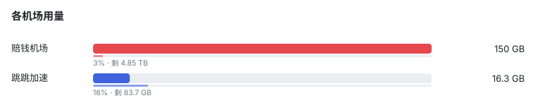
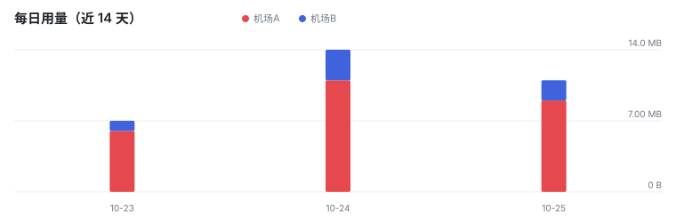
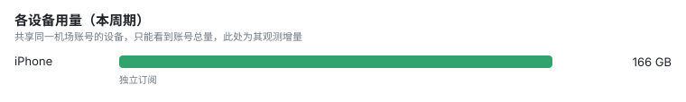

# Airport Traffic Monitor

机场流量监控看板 —— 多设备 × 多机场的代理流量记录与可视化。数据由手机/电脑上的小火箭（Shadowrocket）或 Surge 模块自动上报，GitHub Actions 每次收到数据就重算并重绘下面的面板。

- **在线面板**：https://darveydev.github.io/airport-traffic-monitor/
- **仓库**：darveydev/airport-traffic-monitor

<!-- TRAFFIC:START -->
> 数据更新时间：**2026-10-29 10:24**（Asia/Shanghai）｜本周期起算：2026-10-01｜每次设备上报后自动刷新

**本周期总用量 166 GB**　·　今日 0 B　·　近 24 小时 4.50 GB

### 各机场

| 机场 | 已用 | 套餐 | 剩余 | 到期 |
| --- | ---: | ---: | ---: | --- |
| 赔钱机场 | 150 GB (3%) | 5.00 TB | 4.85 TB | — |
| 跳跳加速 | 16.3 GB (16%) | 100 GB | 83.7 GB | 2026-11-09 |

### 机场 × 设备

| 机场 | iPhone | 机场总计 |
| --- | ---: | ---: |
| 赔钱机场 | 150 GB | 150 GB |
| 跳跳加速 | 16.3 GB | 16.3 GB |

<sub>「共享」= 多台设备用同一个机场账号，机场只给出账号总量，无法再按设备拆开；想要设备级精确数字，让每台设备用独立订阅，或换用能读节点计数的客户端（Surge 等）。</sub>

### 趋势








<!-- TRAFFIC:END -->

## 怎么看

- **在线面板**：[darveydev.github.io/airport-traffic-monitor](https://darveydev.github.io/airport-traffic-monitor/) —— 页面每 30 秒自动拉一次数据，比 README 更及时。已部署完毕，无需再配置。
- **本页（README）**：机场用量、机场 × 设备矩阵、近 14 天 / 近 24 小时趋势图。每次设备上报（默认 10 分钟）后自动刷新。

## 三步开始用

### 1. 填机场订阅

编辑 `config/meter.json`，把 `airports` 里的 `sub` 换成机场订阅链接，`name` 改成你习惯的叫法：

```json
{
  "name": "我的机场",
  "sub": "https://你的机场域名/api/v1/client/subscribe?token=你的token",
  "quotaGB": 500,
  "color": "#e5484d"
}
```

改完直接提交到 `main`，设备端最迟 1 小时内拉到新配置。

### 2. 在小火箭里装模块

把本仓库的 `TrafficMeter.module` 和 `TrafficMeter.js` 放到同一目录（或都用 raw 链接），编辑 module 里那一行 `argument`：

```
repo=darveydev/airport-traffic-monitor&token=你的PAT&device=iPhone&branch=main
```

- `device` 每台设备必须不同（iPhone / iPad / MacBook）
- `token` 用 fine-grained PAT，勾 **Contents: Read and write**，只授权本仓库，设个过期时间

### 3. 等 10 分钟

仓库里出现 `data/devices/<设备名>.json` 就成功了，面板随即刷新。

## 常见问题

| 现象 | 原因与处理 |
| --- | --- |
| 面板一直 0 B | 模块没启用 / PAT 没写权限 / `device` 名和别的设备撞了 |
| 机场显示「未分组」 | `config/meter.json` 里没配这个机场，或 `sub` 链接失效 |
| 数字不涨 | 机场对订阅拉取限流，把 `pollInterval` 调大到 30 |
| 只涨一次就停 | 小火箭把 cron 停了，改用 module 里注释掉的 `http-request` 触发方式 |
| Actions 提交失败 | 仓库 Settings → Actions → General → Workflow permissions 要选 **Read and write**（本仓库已配置好） |

## 目录

| 路径 | 作用 |
| --- | --- |
| `config/meter.json` | 机场列表 + 订阅链接 + 配额，设备端会来拉这份配置 |
| `data/devices/*.json` | 每台设备一个文件，设备端只写自己那份，不会互相覆盖 |
| `scripts/aggregate.mjs` | 聚合去重 + 生成 SVG + 更新 README 数据区 |
| `docs/data/aggregate.json` | 聚合结果，给在线面板读 |
| `docs/assets/*.svg` | README 里引用的图表 |
| `.github/workflows/traffic.yml` | 收到 push 就跑一次聚合 |

## 数据口径

- **机场维度**：数字来自机场订阅响应头 `subscription-userinfo`，是机场自己统计的账号用量，跨设备汇总，最准。
- **设备维度**：每台设备记录自己观测到的用量增量。若多台设备共用一个机场账号，机场只给出账号总量，
  无法再按设备拆分，矩阵里会标「共享」。
- **去重规则**：同一机场被多台设备观测时取最大值（不是相加），避免重复计数；节点级实测（Surge）的设备则按相加。

## 加一台设备

1. 在小火箭里安装 `TrafficMeter.module`，`argument` 里填本仓库的 `repo`、GitHub 令牌，以及**不重复**的 `device` 名。
2. 令牌用 fine-grained PAT，权限只要 `Contents: Read and write`，只授权 `darveydev/airport-traffic-monitor` 这一个仓库，设个过期时间。
3. `argument` 示例：
   `repo=darveydev/airport-traffic-monitor&token=github_pat_xxx&device=iPhone&branch=main`
4. 等 10 分钟，`data/devices/<设备名>.json` 出现即成功。

## 排障

| 现象 | 原因 |
| --- | --- |
| 一直没数据 | 模块没启用 / 令牌没写权限 / 设备名和别的设备撞了 |
| 机场显示「未分组」或缺失 | `config/meter.json` 里没配这个机场，或 `sub` 链接失效 |
| 数字不涨 | 订阅链接被机场限流（部分机场限制拉取频率），把 `pollInterval` 调大 |
| 只涨一次就停 | 小火箭把 cron 停了；模块里换成 http-request 触发方式 |
